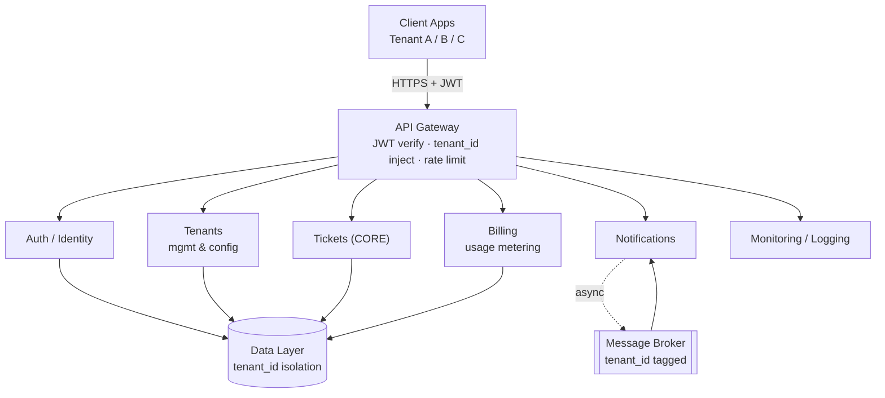

# Helpdesk SaaS — Cloud-Native Multi-Tenant Application

**Author:** Mustafa Saad Fadil
**Course:** Cloud Computing: Fundamentos e Infraestructuras — Prácticas
**Milestone:** Hito 1 — Definición del Proyecto, Modelo de Negocio y Arquitectura

---

## 1. Domain Description

The project is a **multi-tenant Helpdesk SaaS**: a cloud-native application that
lets many customer companies (**tenants**) manage their own support tickets within
one shared platform.

**Business problem:** small and medium companies need professional support-desk
tooling but cannot each afford dedicated infrastructure. A shared SaaS lowers
cost through resource pooling, while each tenant's data must stay isolated from
the others.

**Main use cases:**
- An agent logs, updates and closes support tickets for their own tenant.
- A tenant administrator configures their tenant and manages its agents.
- A tenant only ever sees its own data (isolation).
- The platform operator meters per-tenant usage for billing.

This deliberately avoids a trivial CRUD system: the core value is the **secure
isolation of many tenants on shared infrastructure**, and the empirical study of
that trade-off.

---

## 2. Problem & Proposed Solution

**Problem.** Multi-tenancy creates a tension between *resource pooling* (cost
efficiency) and *isolation* (security and performance). No single isolation model
— **Pool** (shared schema + `tenant_id` filter) or **Bridge** (schema per tenant)
— is optimal for every workload; each trades isolation strength against cost.

**Solution.** A containerised microservices Helpdesk SaaS used as a testbed to
compare Pool and Bridge under controlled multi-tenant load, producing
evidence-based, conditional guidance on when each model (or a hybrid) is right.

**Why it is legitimate.**
- It addresses a real, unsolved engineering trade-off (isolation vs. cost).
- It fills a gap: conditional, *measured* guidance rather than assertion.
- It is grounded in NIST (SP 800-145) and reproducible (version-controlled,
  synthetic data).
- Scope is honestly bounded (Silo and multi-region are out of scope).

---

## 3. NIST SP 800-145 — The 5 Essential Characteristics

Reference: NIST SP 800-145, *The NIST Definition of Cloud Computing*. Verify
against the official document before citing.

| Characteristic | How this application realises it |
|----------------|----------------------------------|
| **On-demand self-service** | Tenants and test environments provisioned programmatically, no manual setup. |
| **Broad network access** | Services reachable over HTTPS from any tenant client. |
| **Resource pooling** | Shared infrastructure is exactly what makes the Pool model and its cost efficiency possible. |
| **Rapid elasticity** | Auto-scaling absorbs spikes (e.g., a heavy tenant) without over-provisioning. |
| **Measured service** | Per-tenant usage metering and monitoring let us *measure* the trade-off, not guess it. |

> Note: *isolation* is not one of the five NIST characteristics; it is a security /
> non-functional requirement. This distinction is deliberate.

---

## 4. NIST SP 500-292 — Actor Mapping

Reference: NIST SP 500-292, *NIST Cloud Computing Reference Architecture*. Verify
against the official source; confirm the exact actor labels with the course brief.

| Actor | Role in this project |
|-------|----------------------|
| **Consumer** | The tenant companies and their agents using the Helpdesk SaaS. |
| **Provider** | The cloud platform delivering compute, database and the SaaS. |
| **Intermediary** | Managed services (managed DB, monitoring, message broker) adding value over raw infrastructure. |
| **Auditor** | Security/compliance review verifying tenant isolation; isolation tests serve as audit evidence. |
| **Carrier / Operator** | The network path (HTTPS) carrying data between clients and services. |

### Economic impact
- **Consumer:** converts fixed IT cost into pay-per-use operating cost, scaling
  with actual usage.
- **Provider:** benefits from resource pooling and economies of scale.
- **Intermediary:** value-added services reduce operational burden and cost.
- **Auditor:** auditable isolation evidence lowers compliance cost.

---

## 5. Architecture

Six microservices behind an API Gateway. Tenant identity is carried in a signed
JWT and propagated via request context; the database enforces isolation.

**Communication protocols:** client↔gateway over HTTPS/REST; gateway↔services
over internal HTTP/REST; notifications↔broker over asynchronous messaging.

**Persistence:** each service owns its datastore (database-per-service).
Isolation enforced by Row-Level Security (Pool) or per-tenant schema (Bridge).

---

## 6. REST API (main endpoints)

Base path: `/api/v1` · Auth: `Authorization: Bearer <JWT>` · `tenant_id` derived
from the JWT, never from the request body.

| Method | Endpoint | Description | Request body | Response |
|--------|----------|-------------|--------------|----------|
| POST | `/auth/login` | Authenticate, issue JWT | `{ "email": "...", "password": "..." }` | `{ "token": "...", "tenant_id": "A" }` |
| POST | `/tickets` | Create a ticket | `{ "subject": "...", "description": "..." }` | `201` `{ "id": 1, "tenant_id": "A" }` |
| GET | `/tickets` | List tenant's tickets | — | `200` `[ { "id": 1 } ]` |
| GET | `/tickets/{id}` | Get one ticket | — | `200` `{ ... }` / `404` if not owner |
| PATCH | `/tickets/{id}` | Update a ticket | `{ "status": "closed" }` | `200` `{ ... }` |
| POST | `/tenants` | Register a tenant (provider) | `{ "name": "..." }` | `201` `{ "id": "B" }` |

Cross-tenant access returns `404` (not `403`) to avoid leaking resource existence.

---

## 7. Repository Structure

    docs/          architecture, ADRs, NIST mapping
    services/      one folder per microservice
    libs/          shared code (tenant-context, auth middleware)
    infrastructure/ Docker, Kubernetes, database (RLS / migrations)
    tests/         load tests + tenant-isolation tests
    .github/       CI/CD workflows, issue & PR templates

---

## 8. Engineering Environment (GitHub)

- **Branch strategy:** `main` (protected) + `feature/<name>` merged via Pull
  Requests with mandatory review and passing CI.
- **Semantic commits:** `feat:`, `fix:`, `docs:`, `refactor:`, `test:`, `chore:`.
  Format: `<type>(<scope>): 
`.
- **Project board:** GitHub Projects grouped by Milestone with the initial backlog.
- **User stories:** recorded as Issues using `.github/ISSUE_TEMPLATE/user_story.md`.
- **CI:** build → lint → unit tests → **isolation tests** → docker build.

---

## 9. Research Questions

- **RQ1:** Trade-off between isolation and cost-efficiency between Pool and Bridge.
- **RQ2:** Effect of the isolation model on latency under multi-tenant load.
- **RQ3:** Secure tenant-context propagation without cross-tenant leakage.

---

## 10. Getting Started

    docker compose up --build

---

## Academic note

This is a master's coursework project. Design decisions are tracked in

