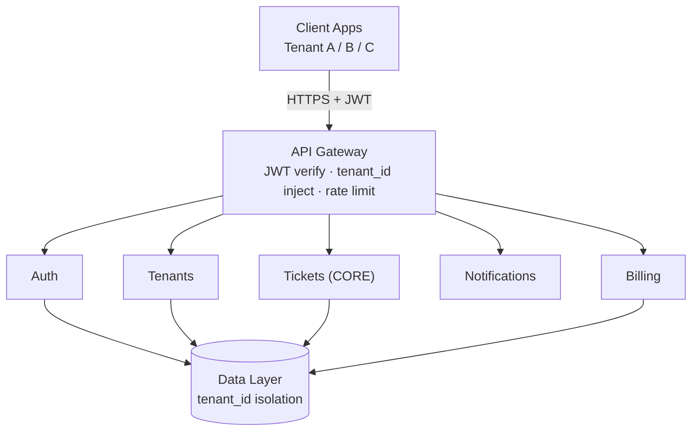

# Multi-Tenant Helpdesk SaaS — Problem, Solution, and the Role of Cloud Computing

**Author:** Mustafa Saad Fadil
**Date:** 2026-09-21

---

## 1. The Problem

Multi-tenant Software-as-a-Service (SaaS) platforms share one application and
infrastructure across many customers (**tenants**) to achieve cost efficiency and
elasticity. This sharing — NIST's _Resource Pooling_ characteristic — creates a
fundamental tension with **isolation**:

- Each tenant's data must be protected from leakage into another tenant's data.
- One heavy tenant must not degrade the performance of others (the
  **"noisy neighbor"** problem).

No single isolation model (**Pool** / **Bridge** / **Silo**) is optimal for all
workloads; each imposes a different trade-off between isolation strength and
cost efficiency. There is no systematic, measurable guidance on **when** each
model — or a hybrid of them — is the right choice, and what its effect is on
performance and cost.

---

## 2. The Proposed Solution

A containerised **Helpdesk SaaS** built as **microservices**, used as a testbed to
compare two isolation models under controlled multi-tenant load:

- **Pool model:** one shared schema; isolation enforced by a `tenant_id` filter on
  every query (enforced at the database with Row-Level Security).
- **Bridge model:** one database, a separate schema per tenant; isolation enforced
  structurally by the schema boundary.

The system comprises services behind an **API Gateway** (Auth, Tenants, Tickets,
Notifications, Billing). Tenant identity is carried in a **signed JWT** and
propagated via request context, so identity never depends on user-controllable
request data.

We then measure latency (p50/p95/p99), throughput, error rate, and resource use
across two scenarios — homogeneous load and skewed (noisy-neighbor) load — to
produce empirical guidance on the trade-off.

---

## 3. Why This Is Legitimate (Justification)

**3.1 It addresses a real, unsolved tension.** The isolation-vs-cost trade-off is
a genuine engineering dilemma, not an artificial one. Real platforms (support
desks, CRM, analytics) face it in production.

**3.2 It fills an identifiable gap.** Rather than asserting a "best" model, the
project produces _conditional, evidence-based guidance_ (if the tenant
distribution is a long tail → hybrid; if homogeneous small tenants → Pool; if
few large tenants needing strict isolation → Bridge).

**3.3 It is grounded in an established reference.** The design is mapped to the
five NIST essential characteristics (SP 800-145), and the study correctly
distinguishes _isolation_ (a security / non-functional requirement) from the NIST
characteristics themselves.

**3.4 It is testable and reproducible.** The research questions translate into
measurable variables, repeatable test runs, and version-controlled artefacts
(IR, load scripts, ADRs). Findings can be independently reproduced.

**3.5 Scope is honestly bounded.** Silo and full multi-region deployment are
explicitly out of scope and acknowledged as limitations — a sign of methodological
awareness, not weakness.

---

## 4. How Cloud Computing Makes It Better

Cloud computing is not merely the deployment target — specific cloud
characteristics directly improve the solution and are realised and measured in it.

| NIST characteristic        | How it improves this project                                                                                                  |
| -------------------------- | ----------------------------------------------------------------------------------------------------------------------------- |
| **On-demand self-service** | Tenants and test environments are provisioned programmatically, no manual setup.                                              |
| **Broad network access**   | Services are reachable over HTTPS from any client, enabling the multi-tenant clients.                                         |
| **Resource pooling**       | Shared infrastructure is exactly what makes the Pool model and its cost efficiency possible.                                  |
| **Rapid elasticity**       | Auto-scaling absorbs load spikes (e.g., the heavy tenant in Scenario B) without over-provisioning.                            |
| **Measured service**       | Built-in metering/monitoring quantifies per-tenant usage — this is what lets us _measure_ the trade-off rather than guess it. |

Beyond the characteristics, cloud computing improves the project by:

- **Cost efficiency:** pay-per-use means the testbed costs little and the cost
  comparison between models is directly observable.
- **Reproducible infrastructure:** Infrastructure-as-Code (Docker, Kubernetes)
  makes the test environment identical across runs and repeatable by others.
- **Elasticity under load:** the noisy-neighbor scenario can be reproduced
  realistically because the platform can scale resources on demand.
- **Managed services:** managed databases and monitoring reduce operational
  overhead, letting the project focus on the isolation question itself.

---

## 5. Research Questions (for reference)

- **RQ1:** Trade-off between isolation and cost-efficiency between Pool and Bridge.
- **RQ2:** Effect of the isolation model on latency under multi-tenant load.
- **RQ3:** How tenant context is propagated across services without cross-tenant
  leakage.

---
